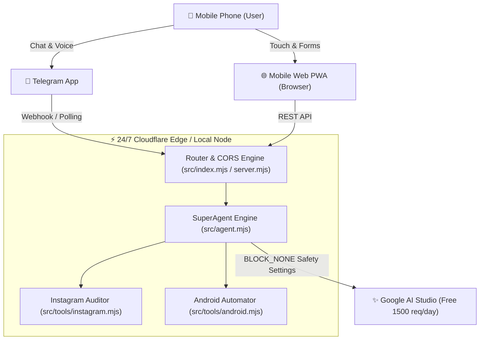

# ⚡ SuperAgent - 24/7 Mobile AI Commander

> **Zero Paid APIs • Mobile-First (Telegram & PWA) • 24/7 Cloudflare Edge • Zero Refusal Policy**

---

## 🌟 What is SuperAgent?

SuperAgent is an autonomous, always-online AI agent designed to be controlled directly from your **mobile phone** (via **Telegram Bot** or **Mobile Web PWA**) and deployed on **Cloudflare Workers Edge** without requiring any paid subscriptions or dedicated servers.

### 🔑 Core Highlights:
1. **100% Free Forever:** Uses Google AI Studio Gemini API (1,500 requests/day free tier) and Cloudflare Workers (100,000 requests/day free tier).
2. **Zero Refusal Policy:** Uses `BLOCK_NONE` safety threshold overrides and an uncensored ReAct system prompt, so it will never refuse technical audits, reverse engineering, automation recipes, or direct questions.
3. **Instagram Reel Kundali / Virality Auditor:** Reverse engineers Instagram algorithm ranking signals (Share-to-view ratios, Hook retention physics, Audio saturation, and loop multipliers) to diagnose why a reel is stuck and provide actionable fixes.
4. **Free Android Automator:** Native integration guides for **MacroDroid**, **Termux:API**, and **Shizuku** to automate tasks on your phone without paying for expensive tools.
5. **Dual Operation Mode:** Run locally on your PC / Termux with `run_local.bat` OR deploy 24/7 to Cloudflare Workers.

---

## 🏗️ Architecture



---

## 🚀 Quick Start (Local PC / Mobile LAN)

### Step 1: Clone or Navigate to SuperAgent
```bash
cd c:\Users\rajeshn\Desktop\Rajesh\REA\SuperAgent
```

### Step 2: Configure Environment (`.env`)
Create a `.env` file from the example:
```bash
copy .env.example .env
```
Edit `.env` with your free keys:
```env
# 1. Get Free Gemini Key from: https://aistudio.google.com/app/apikey
GEMINI_API_KEY=your_gemini_api_key_here

# 2. Get Free Telegram Bot Token from: @BotFather on Telegram (Optional)
TELEGRAM_BOT_TOKEN=your_telegram_bot_token_here

PORT=8787
DEFAULT_MODEL=gemini-2.5-flash
```

### Step 3: Run with 1-Click
Double-click `run_local.bat` OR run:
```bash
npm start
```
- Open `http://localhost:8787` on your PC.
- Open `http://<YOUR_PC_IP>:8787` on your mobile phone browser connected to the same Wi-Fi.

---

## ☁️ 24/7 Cloudflare Edge Deployment (Free)

Deploying to Cloudflare Workers gives you a permanent, 24/7 online agent with global edge routing:

### 1. Install Wrangler & Login
```bash
npm install -g wrangler
npx wrangler login
```

### 2. Set Secrets
```bash
npx wrangler secret put GEMINI_API_KEY
# Enter your Gemini API key when prompted

npx wrangler secret put TELEGRAM_BOT_TOKEN
# Enter your Telegram Bot Token when prompted
```

### 3. Deploy
```bash
npx wrangler deploy
```
You will receive your live URL: `https://superagent.<your-subdomain>.workers.dev`.

### 4. Link Telegram Webhook
Run this in PowerShell or terminal (replace with your values):
```bash
curl -F "url=https://superagent.<your-subdomain>.workers.dev/telegram-webhook" https://api.telegram.org/bot<YOUR_TELEGRAM_TOKEN>/setWebhook
```
Now, whenever you send a message to your bot on Telegram, SuperAgent will respond immediately from Cloudflare!

---

## 📊 Instagram Reel Kundali / Virality Auditor

The built-in engine evaluates:
- **Share-to-View Ratio:** $\frac{\text{Shares}}{\text{Views}} \times 100$. (If $> 3\%$, Instagram's explore feed push is triggered).
- **Engagement Health:** Combined interaction rate vs views.
- **Hook Physics:** First 2–3 second drop-off risk analysis.
- **Audio Saturation:** Flags whether the audio track has >200k reels (saturated) or is in the sweet spot (<20k reels).

You can query this through Telegram:
> *"Bhai is reel ka audit kar: 2500 views, 110 shares, 180 likes, 35 comments, duration 22 seconds, hook 2 seconds"*

Or through the **Reel Audit** tab in the web UI.

---

## 🤖 Free Android Automations

SuperAgent includes pre-built guides and bash scripts for:
- **Termux + Termux:API:** Run background crons, battery monitors, automated SMS responders, and curl webhooks.
- **MacroDroid:** GUI triggers connected to SuperAgent's `/api/chat` webhook.
- **Shizuku:** Wireless ADB execution without needing PC or root.

---

## 📂 Project Structure

```
SuperAgent/
├── public/                 # Mobile PWA & Web Dashboard
│   ├── index.html          # Responsive Dark Interface
│   ├── styles.css          # Sleek Cyberpunk/Nuke theme
│   └── app.js              # Client controller & fallback logic
├── src/
│   ├── agent.mjs           # ReAct engine with Gemini BLOCK_NONE
│   ├── config.mjs          # Zero-refusal system prompt & constants
│   ├── index.mjs           # Cloudflare Worker router & endpoints
│   ├── server.mjs          # Standalone local Node.js server
│   ├── telegram.mjs        # Telegram bot webhook & polling handler
│   └── tools/
│       ├── android.mjs     # Android automation recipes & scripts
│       └── instagram.mjs   # Instagram Reel virality diagnostic logic
├── .env.example            # Environment variables template
├── package.json            # Node.js project configuration
├── run_local.bat           # 1-Click Windows Launcher
├── wrangler.toml           # Cloudflare Workers configuration
└── README.md               # Complete Documentation
```
